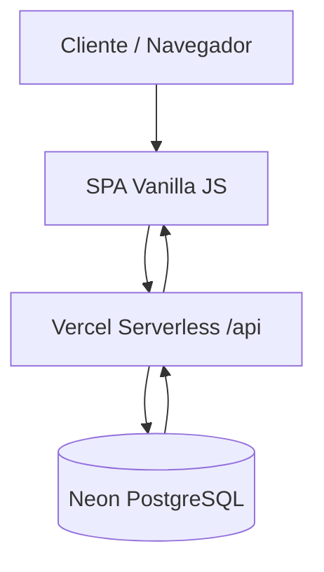

# Arkik Productions — Executive Operating System & Booking Engine

> **Repository:** [https://github.com/esmoliname/arkik_productions_web](https://github.com/esmoliname/arkik_productions_web)

Plataforma ejecutiva de alto rendimiento (SPA) y sistema operativo de gestión de eventos, cotizaciones dinámicas, validación bancaria **SINPE Móvil**, motor de búsqueda y agregación determinista (**ArkikRAGEngine**) y subsistema de generación de documentos contractuales en **PDF y DOCX** para **Arkik Productions** (Granadilla, Curridabat, San José, Costa Rica).

---

## Project Overview

Arkik Productions es una plataforma web que combina un catálogo público de servicios musicales y sonido con un motor de reservas transaccionales y un panel administrativo. El sistema gestiona cotizaciones en tiempo real, disponibilidad de agenda, validación de comprobantes SINPE Móvil, auditoría de operaciones y exportación de prefacturas en PDF/DOCX.

Funcionalidades principales:

- Catálogo de servicios musicales (Banda RT, Trío, Dúo, Solista, Alquiler de Sonido).
- Wizard de reserva de 4 pasos con cálculo dinámico de horas extra, DJ en recesos, subwoofers y viáticos.
- Validación de disponibilidad por fecha/hora con bloqueo automático por capacidad.
- Validación bancaria SINPE Móvil con comprobante (voucher) y aprobación administrativa.
- Panel administrativo con dashboard, métricas financieras, auditoría y gestión de precios.
- Generación de prefacturas en PDF (A4) y Word (.docx).
- Motor de búsqueda operativa determinista (ArkikRAGEngine) sobre reservas activas.

---

## Architecture

Arquitectura real del proyecto (no se usa Cloudflare en la arquitectura objetivo):

- **Frontend:** Vanilla JavaScript SPA (ES2022+), CSS3 con variables de diseño líquido y Tailwind CSS. Sin frameworks de UI.
- **Backend:** Vercel Serverless Functions (Node.js 22+) bajo `/api`.
- **Database:** Neon PostgreSQL (server-side only, vía `DATABASE_URL`).
- **Persistencia remota primero:** La fuente de verdad de las reservas es Neon PostgreSQL a través de `/api`. `LocalStorage` se utiliza únicamente para caché, preferencias y borradores/cola offline no confirmada. El sistema **no** simula confirmaciones cuando el backend no responde.



Módulos principales:

- `js/data.js`: Catálogo, mapa geográfico (7 provincias, 84 cantones, GAM vs. Fuera de GAM), configuración SINPE y constantes.
- `js/app.js`: Núcleo reactivo — `ArkikAssets`, `CartState`, `PriceManager`, `BookingStore`, `ArkikRAGEngine`, `ModalController`, exportación documental.
- `js/api.js`: Cliente HTTP hacia `/api` con manejo de errores y reintentos.
- `api/_lib/*`: Librerías compartidas (config, auth, db, cors, log, respond, repo, service, ratelimit, registry, logic).
- `api/admin/*`: Endpoints administrativos protegidos por sesión.
- `api/bookings/*`, `api/availability/*`, `api/pricing.js`: Endpoints públicos y administrativos.

---

## Requirements

- Node.js 22+ (ver `package.json` `engines.node`).
- npm.
- Git.
- Cuenta y base de datos Neon PostgreSQL para integración.
- Cuenta Vercel para despliegue.

---

## Installation

```bash
npm install
```

---

## Development

Iniciar el servidor de desarrollo estático:

```bash
npm run dev
```

También se puede abrir `index.html` directamente en el navegador o mediante Live Server.

Comprobación de sintaxis:

```bash
npm run check
```

---

## Environment Variables

Variables de entorno (nombres y propósito). **Nunca incluir valores reales.** Usar placeholders seguros.

| Variable | Propósito |
|---|---|
| `DATABASE_URL` | Cadena de conexión PostgreSQL de Neon (solo server-side). |
| `APP_ENV` | Entorno: `development`, `preview` o `production`. |
| `SEED_MODE` | `true` permite insertar datos demo (solo desarrollo local); `false` en producción. |
| `ADMIN_OWNER_PIN` | PIN del rol Owner (solo server-side, nunca en código ni cliente). |
| `ADMIN_IT_PIN` | PIN del rol IT (solo server-side). |
| `ADMIN_SESSION_SECRET` | Secreto para firmar tokens de sesión (64+ caracteres aleatorios). Obligatorio en producción. |
| `ALLOWED_ORIGINS` | Orígenes permitidos para CORS (separados por coma). Vacío = same-origin únicamente. |
| `PUBLIC_APP_URL` | URL pública de la app (para links/emails). |

Copiar `.env.example` a `.env.local` para desarrollo. Nunca commitear `.env` real.

---

## Database

- **Neon PostgreSQL** como base de datos oficial.
- Migraciones en `db/migrations/` (`001_initial_schema.sql`, `002_indexes.sql`, `003_config_seed.sql`).
- Inicialización: `npm run db:migrate`.
- Semillas de desarrollo: `npm run db:seed:dev` (solo con `SEED_MODE=true`).
- Separación de entornos por `DATABASE_URL` y `APP_ENV`.
- Bases vacías: el sistema arranca vacío en producción (`SEED_MODE=false`); no se insertan datos demo.
- Protección de datos existentes: las migraciones son idempotentes (`ON CONFLICT`); no se sobrescriben datos de producción.

---

## API

### Endpoints públicos

| Método | Ruta | Descripción |
|---|---|---|
| `GET` | `/api/health` | Estado del servicio. |
| `POST` | `/api/bookings` | Creación de reserva (rate limited, idempotente). |
| `GET` | `/api/availability` | Mapa de disponibilidad bloqueada (+ `?date=`, `?from=&to=`). |
| `GET` | `/api/pricing` | Precios públicos (catálogo, overrides, rates). |

### Endpoints administrativos (requieren sesión)

| Método | Ruta | Descripción |
|---|---|---|
| `POST` | `/api/admin/login` | Autenticación por PIN. |
| `GET` | `/api/admin/session` | Sesión actual o 401. |
| `POST` | `/api/admin/logout` | Cierre de sesión. |
| `GET` | `/api/admin/dashboard` | Payload del panel administrativo. |
| `GET` | `/api/admin/stats` | Agregados. |
| `GET` | `/api/admin/audit` | Eventos de auditoría. |
| `GET/PUT` | `/api/admin/pricing` | Gestión de precios (PUT solo Owner). |
| `GET` | `/api/bookings` | Listado de reservas (admin). |
| `GET/PATCH` | `/api/bookings/[code]` | Detalle / edición de contacto. |
| `PATCH` | `/api/bookings/[code]/status` | Transición de estado. |
| `PATCH` | `/api/bookings/[code]/reschedule` | Reagendamiento. |
| `PUT/DELETE` | `/api/availability` | Gestión de disponibilidad (solo Owner). |

---

## Security

- **Autenticación:** PIN administrativo validado exclusivamente en el servidor, hashes scrypt con salt único, comparación en tiempo constante.
- **Sesiones:** Tokens aleatorios firmados con HMAC-SHA256 (stateless `v1.`) o sesiones persistidas en DB con expiración deslizante (15 min). Cookies `HttpOnly`, `Secure` en producción, `SameSite=Strict`.
- **Roles:** `owner` e `it`, verificados en el servidor. Operaciones sensibles (precios, disponibilidad) reservadas al Owner.
- **Protección de login:** Rate limiting por IP, por IP+rol y global por rol; backoff progresivo temporal; sin bloqueo permanente del administrador por intentos fallidos de terceros.
- **Variables de entorno:** `ADMIN_SESSION_SECRET` obligatorio en producción (el getter lanza si no está configurado). Ningún secreto en el frontend.
- **CORS:** Same-origin por defecto; orígenes explícitos cuando se configuran. Preflight restringido.
- **Logs:** Redacción automática de secretos, PINs, tokens, cookies y URLs de conexión.
- **Auditoría:** Eventos de login, logout, cambios de estado, precios y disponibilidad.

---

## Testing

```bash
npm test
```

Suites existentes:

- `test/api-client.test.cjs`: Cliente HTTP, idempotencia, rate limiting, manejo de errores.
- `test/behavior.test.cjs`: Comportamiento de handlers (auth, métodos, DB caída).
- `test/contract.test.cjs`: Contratos de availability range y pricing.
- `test/load.test.cjs`: Carga de módulos y registro.
- `test/logic.test.cjs`: Lógica de negocio (precios, capacidad, transiciones, validación).

No se eliminan pruebas para obtener resultados positivos.

---

## Deployment

Preparación para:

- **Vercel Preview:** Entorno de prueba con su propia `DATABASE_URL` y credenciales.
- **Vercel Production:** `SEED_MODE=false`, `ADMIN_SESSION_SECRET` obligatorio, `APP_ENV=production`.
- **Neon PostgreSQL:** Base de datos por entorno (desarrollo/preview/producción).
- **Dominio personalizado:** Configurar en Vercel; usar `PUBLIC_APP_URL`.

No incluir credenciales ni URLs privadas con parámetros sensibles en la documentación.

---

## Documentation Index

- [`docs/ARCHITECTURE.md`](docs/ARCHITECTURE.md)
- [`docs/DATABASE.md`](docs/DATABASE.md)
- [`docs/API_REFERENCE.md`](docs/API_REFERENCE.md)
- [`docs/SECURITY_AUDIT.md`](docs/SECURITY_AUDIT.md)
- [`docs/DEPLOYMENT_GUIDE.md`](docs/DEPLOYMENT_GUIDE.md)
- [`docs/QA_REPORT.md`](docs/QA_REPORT.md)
- [`docs/CATALOG_AUDIT.md`](docs/CATALOG_AUDIT.md)
- [`docs/PRODUCTION_READINESS_REPORT.md`](docs/PRODUCTION_READINESS_REPORT.md)

---

© 2026 **Arkik Productions** — Música en Vivo & Sonido Profesional — Granadilla, San José, Costa Rica.
