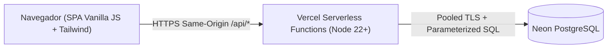

# Arkik Productions — Plataforma Ejecutiva & Motor de Reservas Zero-Trust

> **Producción:** Vercel Serverless + Neon PostgreSQL · **Costa Rica (`America/Costa_Rica` / `UTC-6`)**

Plataforma web ejecutiva (SPA) y sistema operativo de reservas musicales, cotizaciones dinámicas, validación bancaria **SINPE Móvil**, consola administrativa y exportación documental (**PDF A4** y **Word `.docx`**) para **Arkik Productions** (Granadilla, San José, Costa Rica).

---

## 1. Arquitectura del Sistema



- **Frontend (`index.html`, `css/styles.css`, `js/data.js`, `js/api.js`, `js/app.js`):** SPA sin frameworks pesados ni compilación obligatoria, con `SafeStorage` + `MemoryStorage` para resiliencia en navegación privada y manejo defensivo de dependencias CDN (`html2pdf`, `docx`, `EmailJS`) con impresión controlada por DOM.
- **Backend (`api/`):** Funciones Serverless en Node.js 22+ bajo `/api/*` con capa de dominio pura en `api/_lib/logic.js`, repositorio transaccional en `api/_lib/repo.js` y controladores de servicio en `api/_lib/service.js`.
- **Persistencia (`db/`):** Neon PostgreSQL como fuente única de verdad autoritativa. El cliente opera en modo *remote-first* sin colas offline no verificadas.

---

## 2. Seguridad Zero-Trust

- **Autenticación y Sesiones:** PINs administrativos validados exclusivamente en servidor con `scrypt` + salt único y comparación en tiempo constante. Sesiones persistidas en PostgreSQL (`admin_sessions`) con expiración deslizante de 15 minutos y cookie `__Host-session` (`HttpOnly; Secure; SameSite=Strict; Path=/`).
- **Autoridad de Precios (`PRICE_MISMATCH`):** El cliente **no** envía montos en `POST /api/bookings`. El servidor recalcula tarifa base, horas extra, DJ, subwoofers, recargo fuera de GAM (12 %) y adelanto SINPE (50 %) directamente desde PostgreSQL.
- **Rate Limiting Distribuido:** Control de tasa por IP real (`x-vercel-forwarded-for` / `x-real-ip` / `x-forwarded-for`) y por IP+rol respaldado por PostgreSQL (`rate_limits`), complementado por `ClientThrottler` persistente en `SafeStorage`.
- **Zona Horaria Oficial (`UTC-6`):** Tanto el backend (`api/_lib/logic.js`) como el calendario del cliente (`CalendarModule.getThresholds()`) anclan "hoy", la antelación mínima de **72 horas** y el horizonte de **365 días** a hora fija de Costa Rica (`UTC-6`, sin DST).
- **Anti-XSS y Sanitización:** Escape de entradas, lista blanca estricta de estados (`sanitizeBookingStatusClass`) y renderizado seguro con `textContent` en vistas administrativas.
- **Endurecimiento HTTP (`vercel.json`):** `Strict-Transport-Security`, `X-Content-Type-Options: nosniff`, `X-Frame-Options: DENY`, `Referrer-Policy`, `Permissions-Policy` y `Content-Security-Policy-Report-Only`.

---

## 3. Módulos Operativos

- **Cotizador y Reserva en 4 Pasos:** Selección de formato musical, calendario inteligente con bloqueo de 72 h, límite de 2 eventos/día y margen logístico de ±5 h entre shows, cálculo geográfico GAM vs. Fuera de GAM (7 provincias / 84 cantones) y carga de comprobante SINPE Móvil (50 %).
- **Consola Ejecutiva de Propietario (`owner`):** Dashboard KPI, calendario operativo mensual con detalle de logística por día, transiciones de estado (`pendiente` → `confirmada` → `realizada` / `cancelada`), reprogramación, bloqueo de fechas y gestión dinámica de tarifas.
- **Suite de Ingeniería TI (`it`):** Diagnóstico de almacenamiento, telemetría de auditoría y verificación operativa (sin permisos de mutación sobre precios, disponibilidad ni reservas).
- **Biblioteca Multimedia (`#biblioteca`):** Galería Bento filtrable con lightbox accesible y ergonomía táctil móvil.
- **Subsistema Documental:** Pre-factura A4 y Reportes Ejecutivos en PDF (`html2pdf.js`) y Word (`.docx`), con degradación limpia a vista de impresión controlada ante bloqueos de CDN.

---

## 4. Guía Rápida de Desarrollo y Pruebas

### Requisitos
- **Node.js 22+** y **npm**
- Base de datos **Neon PostgreSQL**

### Instalación y configuración local
```bash
npm install
cp .env.example .env.local
```

Genera un secreto de sesión seguro (`ADMIN_SESSION_SECRET`, mínimo 64 caracteres hex):
```bash
node -e "console.log(require('crypto').randomBytes(48).toString('hex'))"
```

Completa en `.env.local` tu `DATABASE_URL` (pooled), `DIRECT_DATABASE_URL` (direct, solo migraciones), `ADMIN_OWNER_PIN`, `ADMIN_IT_PIN` y `ADMIN_SESSION_SECRET`. **Nunca subas `.env`, `.env.local` ni `.dev.vars` al repositorio.**

### Migraciones y arranque local
```bash
# Aplicar esquema y semillas de configuración inicial en Neon
npm run db:migrate

# Iniciar servidor full-stack local (SPA + /api/*)
npm run dev
```

### Validación y pruebas
```bash
# Verificación de sintaxis JS en frontend, DB y scripts
npm run check

# Suite completa de pruebas unitarias, de integración y seguridad (offline mocks)
npm test

# Compuerta completa pre-despliegue (sintaxis + 18+ suites + invariantes estáticos RBAC/SQL/headers)
npm run predeploy:check
```

---

## 5. Despliegue en Vercel + Neon

1. Conecta el repositorio en **Vercel** y configura las variables de entorno en **Project Settings > Environment Variables**:
   - `DATABASE_URL` (endpoint `-pooler` de Neon con rol mínimo `arkik_app`)
   - `ADMIN_SESSION_SECRET` (64+ caracteres aleatorios)
   - `APP_ENV=production`
   - `SEED_MODE=false`
   - `ALLOWED_ORIGINS` (vacío para *same-origin*)
   - *(No agregues `DIRECT_DATABASE_URL` ni `DIRECT_ADMIN_DATABASE_URL` al runtime de Vercel).*
2. Ejecuta `npm run db:migrate` desde tu entorno seguro apuntando a la base de producción antes del primer tráfico.
3. Verifica liveness y readiness tras el despliegue:
   - `GET /api/health` → `200 OK`
   - `GET /api/ready` → `200 OK` (confirma conectividad real con Neon `SELECT 1`)

---

© 2026 **Arkik Productions** — Música en Vivo & Sonido Profesional — Granadilla, San José, Costa Rica.
